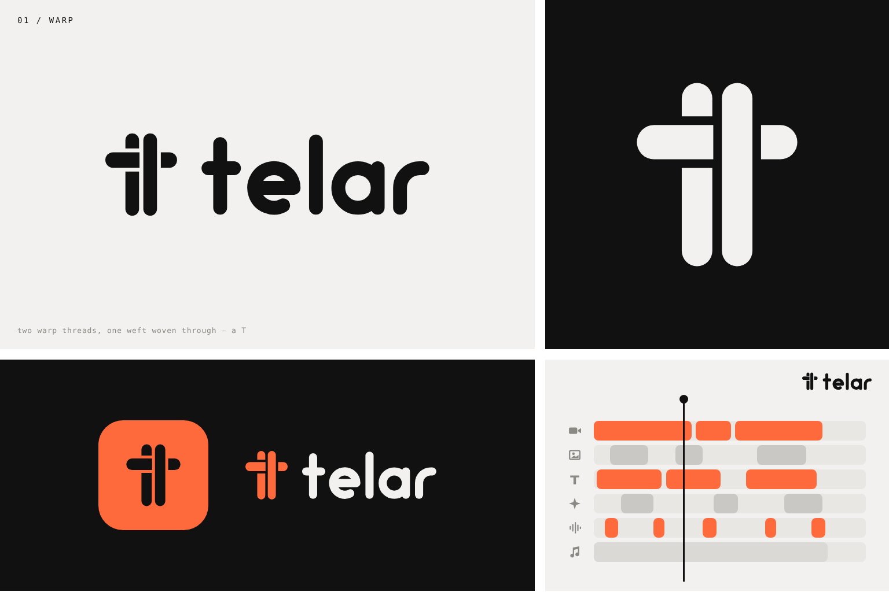
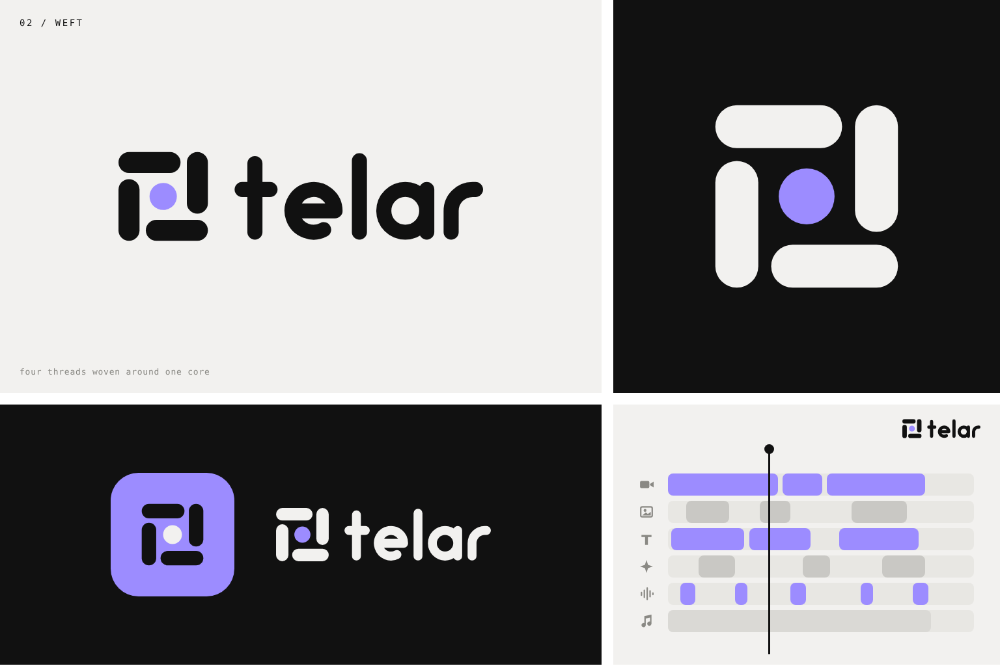
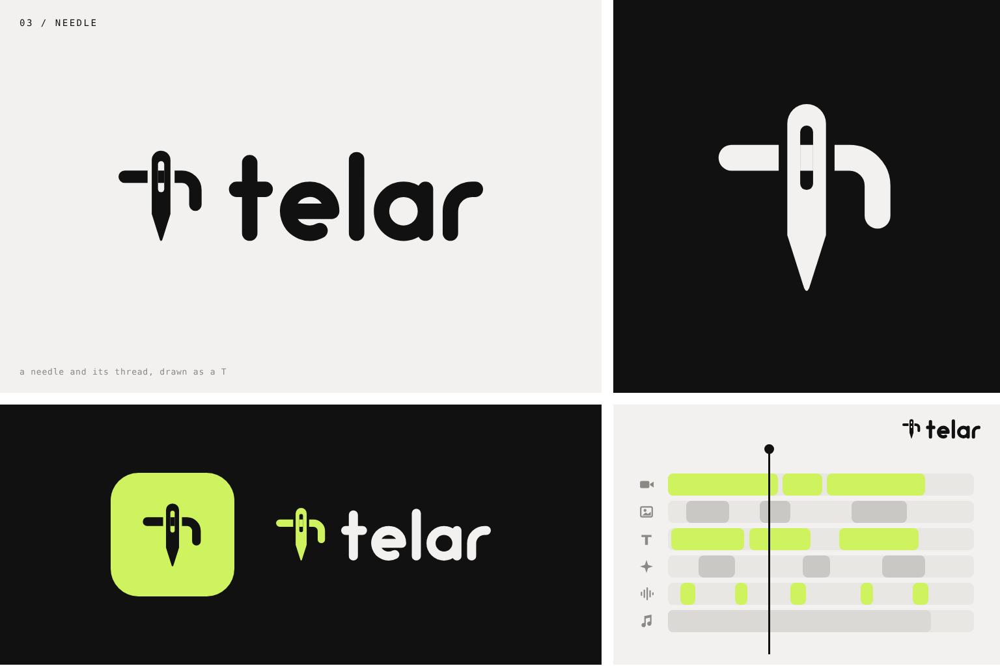
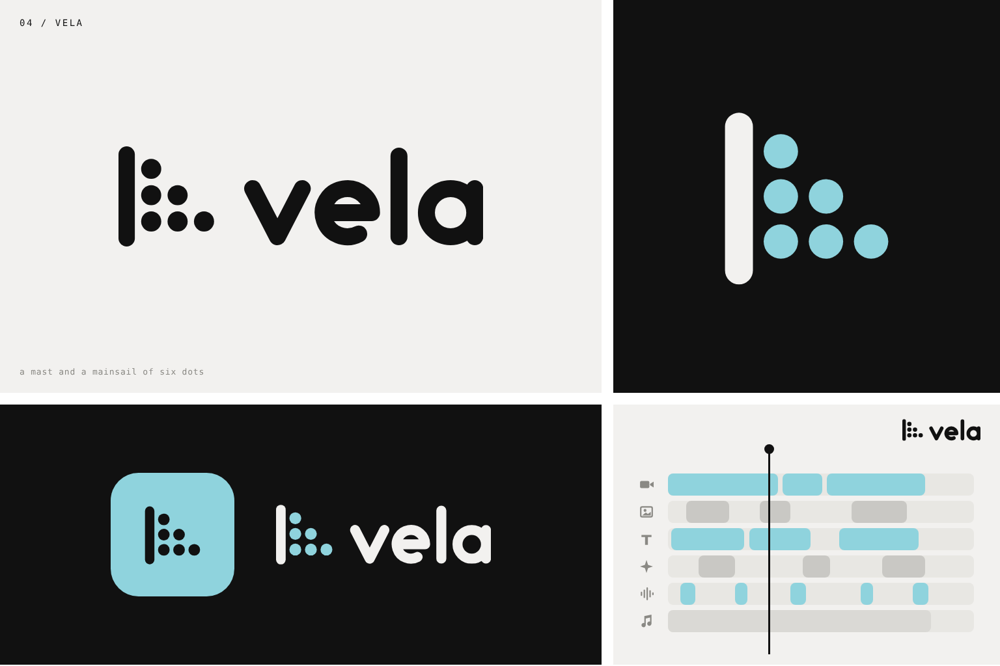

# Telar / Vela: logo concepts

An AI editing platform: clients bring raw footage and leave with a finished, premium reel
(captions, motion graphics, B-roll, transitions, sound effects, music).

*Telar* is Spanish for **loom**, and *vela* means **sail** (sailcloth is woven canvas). So every mark comes
from the same idea: **loose threads woven into one finished piece**, which is what happens to the footage.
The visual language follows the references: heavy rounded geometry, a monoline geometric wordmark with
round terminals, warm grey paper + near-black ink + one accent per concept.

| # | Concept | Brand | Idea | Accent |
|---|---------|-------|------|--------|
| 01 | **Warp** | telar | Two warp threads (ElevenLabs-style bars) with one weft woven *over* the left and *under* the right, so the shape reads as a **T**. | coral `#FF6A3D` |
| 02 | **Weft** | telar | Four thread pills in a pinwheel basket weave around one core dot: the threads (cuts, captions, sound, B-roll) woven around the AI. Rotational, so it can spin as a loader. | violet `#9C8CFF` |
| 03 | **Needle** | telar | A needle forms the stem and the thread runs through its eye as the crossbar, with the loose tail hanging off. The hanging tail keeps it from reading as a dagger. | lime `#CFF35E` |
| 04 | **Sail** | vela | A mast and a mainsail of six dots (3-2-1), the same dot count and rhythm as the dot reference. The sail also reads as a play/forward shape. | cyan `#8FD3DD` |

## Palette

| Role | Hex |
|------|-----|
| Ink | `#111111` |
| Paper | `#F2F1EF` |
| Accents | coral `#FF6A3D` · violet `#9C8CFF` · lime `#CFF35E` · cyan `#8FD3DD` |

## Files

- `svg/`: every mark (`*-mark.svg` ink, `*-mark-light.svg` for dark backgrounds), horizontal lockups
  (`*-lockup.svg` / `*-lockup-light.svg`), app icons (`*-appicon.svg`) and the two wordmarks.
  Marks sit on a 200×200 artboard. The wordmarks are custom monoline strokes (x-height 100, stroke 26), so no font is needed.
- `boards/`: 1536×1024 presentation boards (wordmark, mark on dark, app icon + lockup, timeline UI).
- `app-icons/`: 1024px PNG app icons with transparent corners.
- `tools/`: the generators. `python3 tools/build.py <out>` writes the SVGs; `python3 tools/board.py <out>` writes
  the board HTML; `node tools/render.js <in.html> <out.png> 1536 1024` renders a board with Playwright.

## Other directions explored

- **Weave T / Cut T** (first round, molo-style): a T whose crossbar interlaces with the stem, and a T whose crossbar is
  split into timeline clips. Superseded by Warp.
- **Play dots / Reel dots**: six dots packed into a play triangle, and a six-dot ring around an accent hub.
  Neither shows weaving, so both were dropped in favour of Weft and Sail.
- **Ring loom**: a thread weaving in and out of the six-dot ring. At the reference proportions the turns get too tight
  and the shape collapses into a propeller.
- **Shuttle sail / thread sail / woven V** for Vela: these read as an "S", a signpost and a checkmark.
- Motion idea: the Weft pinwheel spins while a project renders, and the Sail's six dots fill in one by one as the edit
  progresses.
